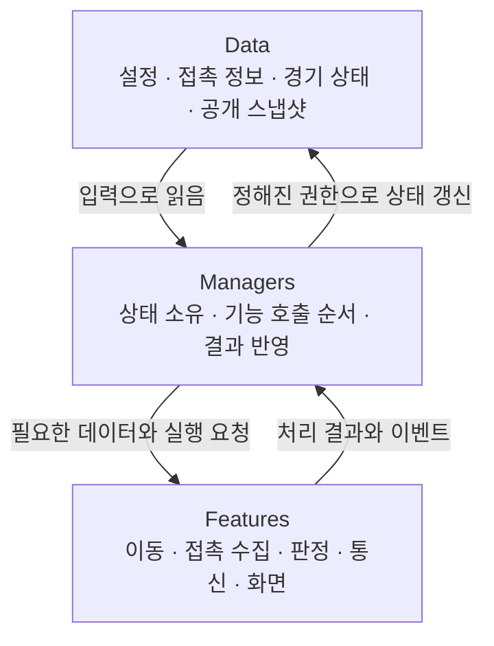
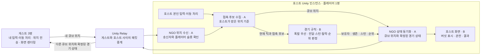

# 독버섯 폭탄 주의보 멀티플레이 아키텍처

호스트 1명과 게스트 3명이 참가하는 첫 빌드 기준임. Unity Relay는 게스트와 호스트 사이의 패킷을 중계함. 각 클라이언트가 자기 플레이어를 움직이고 위치를 전송함. 호스트는 수신한 위치를 기준으로 버섯 전달·폭발·탈락을 판정함.

## 데이터·매니저·기능 구조



- **Data** · 값을 보관함. Unity 입력, 네트워크 호출, 물리 처리, 화면 갱신을 실행하지 않는 데이터 타입으로 작성함.
- **Managers** · 담당 영역의 상태와 실행 순서를 관리함. 기능별 스크립트를 호출하고 반환된 결과를 반영함.
- **Features** · 스크립트 하나에 책임 하나를 둠. 이동 스크립트는 이동, 전달 규칙은 전달 가능 여부, 화면 스크립트는 해당 화면 표시를 처리함. 같은 기능에 속한 여러 메서드는 한 스크립트에 둘 수 있음.
- **연결** · 매니저가 필요한 의존성을 기능에 전달함. 기능은 인자로 받은 데이터를 사용하고 결과·이벤트를 반환함. 다른 매니저의 전역 상태를 찾아 직접 변경하는 방식은 피함.

## 폴더와 담당 스크립트

게임 에셋의 폴더명은 영문으로 사용함. 씬은 `Assets/Scenes`에 배치함.

```text
Assets/
├─ Prefabs/
├─ Resources/
│  ├─ Models/
│  │  ├─ Characters/
│  │  └─ Maps/
│  ├─ Sprites/
│  └─ Sounds/
├─ Scripts/
│  ├─ Managers/
│  ├─ Data/
│  └─ Features/
│     └─ Editor/
└─ Scenes/
```

아래 이름은 구현 기준임. 실제 기능을 구현하는 시점에 필요한 파일을 생성함. Unity·NGO에서 제공하는 동기화 컴포넌트도 해당 기능으로 재사용함.

### Assets/Scripts/Data

- `SessionData` · 방 코드, 참가자 슬롯, 연결·로딩 상태.
- `PlayerStateData` · 슬롯, 생존 여부, 스턴 종료 틱, 순위.
- `MatchStateData` · 경기 단계, 보유자, 폭발 예정 틱, 참가자별 경기 상태, 우승자. 호스트의 경기 판정용 원본.
- `MatchSnapshotData` · 클라이언트에 공개하는 경기 단계, 보유자, 생존·스턴 상태, 순위와 우승자.
- `ContactCandidateData` · 접촉한 슬롯 쌍과 거리 비교값.
- `MatchSettingsData` · 이동 속도, 폭발·스턴 지속 시간, 접촉 판정 크기.

### Assets/Scripts/Managers

- **A · `SessionManager`** — 방 생성·참가·시작·이탈 순서를 관리함. 연결 기능과 플레이어 생성 기능을 호출함.
- **B · `MatchManager`** — 호스트의 경기 상태를 소유함. 매 틱 폭발 우선, 전달, 스턴·탈락, 종료 판정 순서를 조율함. A가 네트워크 실행 흐름에 연결함.
- **B · `HudManager`** — 공개 경기 상태와 내 슬롯을 읽고, 대기·플레이·관전·결과 화면 전환을 조율함.

### Assets/Scripts/Features

- **A · Networking** — `RelaySessionConnector`는 연결 생성·참가·종료, `NetworkPlayerSpawner`는 플레이어 생성·제거, `MatchStateReplicator`는 공개 경기 상태 송수신을 각각 담당함.
- **A · Movement** — `RigidbodyMovement`가 소유자 입력을 이동 힘으로 적용함. `WallContactResponse`가 벽 법선과의 내적으로 벽 안쪽 힘을 구해 같은 크기의 반대 힘을 적용함. `PlayerMovementBlocker`는 플레이어 사이의 힘 전달을 막고 진행 방향을 제한함. `OwnerNetworkTransform`이 위치를 동기화함.
- **A · Contacts** — `PlayerContactCollector`는 호스트가 받은 위치로 새 접촉과 접촉 해제를 수집함. 전달·탈락 여부는 규칙의 판정 결과로 받음.
- **B · Rules** — `BombTransferRule`, `BombExplosionRule`, `PlayerStunRule`, `RankingRule`로 전달, 폭발, 스턴, 순위·우승 확정을 나눔. 현재 상태와 틱·접촉 정보를 입력받아 판정 결과를 반환함.
- **B · Views** — `LobbyView`, `SurvivalHudView`, `SpectatorView`, `ResultView`가 각 화면을 표시함. 동일한 상태 형식으로 테스트 데이터와 실제 네트워크 데이터를 표시함.

## 작성·검토 기준

- 데이터와 실행 기능을 별도 파일로 둠. 데이터 타입에는 해당 값의 생성·유효성 확인에 필요한 코드만 둠.
- `MatchManager`는 `BombTransferRule`을 호출해 전달 결과를 적용함. 접촉 거리 계산이나 HUD 색상 변경은 해당 기능 스크립트가 처리함.
- `RigidbodyMovement`는 로컬 입력과 이동 상태만 사용함. 경기 우승자 결정이나 세션 종료는 담당 매니저로 전달함.
- `MatchStateReplicator`는 호스트 원본에서 공개 스냅샷을 전달함. 숨긴 폭발 시각은 원본에만 보관함. 클라이언트 수신 상태는 HUD와 이동 제한에 전달함.
- 파일 설명에 서로 다른 책임이 나열되면 책임별로 분리함. 매니저에는 호출 순서와 상태 반영 코드가 모이도록 검토함.

## 씬 전환

- `MultiplayerLobby` 씬에 세션, 슬롯 상태, 로비 화면을 유지함. 경기장·벽·카메라·스포너·스폰 지점은 `InGame` 씬에 배치함.
- 호스트가 시작 참가자를 고정하고 `LoadingInGame`을 공유함. `InGameSceneLoader`가 NGO Additive 로드를 요청함.
- 시작 참가자 전원의 로드 완료를 확인한 다음 `Starting`으로 전환함. `NetworkPlayerSpawner`가 경기 씬의 지점 중 중복 없이 무작위 배정하고, 모든 소유자의 스폰 확인 후 `Playing`으로 전환함.
- 경기 씬이 열릴 때 로비 카메라와 로비 배경을 숨김. 방을 떠날 때는 연결을 종료하고 경기 씬을 언로드한 뒤 로비를 다시 표시함.

## 목표 런타임 흐름



- **세션 시작** · A가 참가 코드를 발급함. 일반 빌드는 호스트 포함 4명, Unity 에디터와 Development Build는 1명부터 시작을 승인함. 참가자의 스폰 확인이 끝나면 경기 진행으로 전환함.
- **물리 틱** · A가 이번 틱에 새로 닿은 플레이어 쌍을 모음. B의 규칙은 접촉이 없는 틱에도 실행돼 폭발 여부를 확인함. 같은 틱의 접촉과 만료가 겹치면 폭발을 우선하는 첫 빌드 합의안을 적용함.
- **화면 갱신** · 게스트는 원격 큐브 위치를 보간하고, 각자의 HUD에 확정된 보유자와 생존·순위를 표시함. 숨은 폭발 시각은 호스트가 관리함. B는 HUD에 테스트용 경기 상태를 공급해 접속 구현 전에 관전·결과 전환을 확인할 수 있음.
- **이동 제한** · 클라이언트는 호스트가 확정한 스턴·탈락 상태를 자기 이동 코드에 적용함.

현재 이동 틀은 호스트의 중복 없는 무작위 스폰으로 시작함. `PlayerCollisionManager`가 호스트의 마지막 안전 위치에서 수신 위치까지 검사하고, 첫 접촉 이전 위치를 소유자에게 전달함. `PlayerPositionCorrection`이 물리 틱에서 위치와 접촉면 안쪽 속도 성분을 보정함.

[A 작업지침서](./multiplayer-work-guide-a.md) · [B 작업지침서](./multiplayer-work-guide-b.md) · [GitHub Mermaid 문서](https://docs.github.com/en/get-started/writing-on-github/working-with-advanced-formatting/creating-diagrams)
